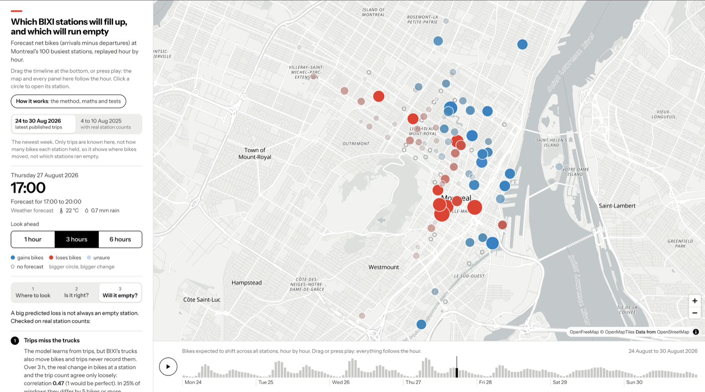

# BIXI dock forecast

Which BIXI stations will fill up, and which will run empty, over the next 1, 3 and 6 hours, and which ones should a truck check first? This project forecasts **net bikes** (arrivals minus departures) at Montreal's 100 busiest stations, gives a range for how sure it is, tests itself on three summers it never saw, and then checks the forecast against real station counts.

This is a **backtest, not a live service**: the model learns from summers 2022 and 2023, and every forecast for summers 2024 to 2026 uses only what was known before that hour. The map replays the forecasts the model would have made, next to what actually happened.

**Run the map locally** with `./run_map.sh` (opens <http://localhost:8765>). A hosted version is coming.



## Why it matters

A station never closes. It lets riders down in one of two ways: you walk to it and there is no bike, or you arrive by bike and there is no free dock, so you ride on to another station. Operators fix this by moving bikes with trucks, and there are always more stations in trouble than trucks: BIXI's dispatchers set each station's acceptable range by hand and pick which stations to serve mostly by location ([Silva, Aloise and Jena, Omega 2024](https://doi.org/10.1016/j.omega.2024.103141), describing the 2019 and 2020 seasons). The question this project answers is the one in the middle of that process: where is the imbalance coming, and which stations should be checked first?

## What you can open

- **The map** (`web/index.html`): stations as circles (blue gains bikes, red loses them, faded means unsure), a timeline to replay a week hour by hour, a look-ahead switch (1, 3, 6 hours), and three tabs that read in order:
  1. **Where to look**: the 10 stations to check for the selected hour, with what really happened.
  2. **Is it right?**: how the forecast scores against simple rules.
  3. **Will it empty?**: why a big predicted loss is not always an empty station, and which ranking finds real problems.
- **Two replay weeks**, switched at the top of the sidebar:
  - **24 to 30 August 2026**, the latest published trips. "Where to look" lists the 10 largest forecasts.
  - **4 to 10 August 2025**, with real station counts. "Where to look" ranks stations by bikes now plus the forecast, the method that worked best in testing, and shows whether each really ran empty or filled up.
- **The method page** (`web/method.html`): a technical note with the maths, the model, the tests, every result and a worked example, read from the same data file as the map.

## Results

All tests are forward: the model learns from summers 2022 and 2023 only and is scored on summers 2024 to 2026 with the weather forecasts that existed at the time. Questions for the later checks were written down before their results were seen (dated plans).

**1. Accuracy.** Average miss in bikes on the 10% of windows with the biggest change (879,339 station-hours per look-ahead):

| Look ahead | Predict zero | Last 4 weeks | Level 2 (gradient boosting) | Level 2 vs the 4-week average |
|---|---|---|---|---|
| 1 hour | 14.8 | **9.4** | 9.4 | 1% worse |
| 3 hours | 31.8 | 14.5 | **13.9** | 4% better |
| 6 hours | 52.9 | 20.1 | **18.5** | 8% better |

A plain 4-week average of the same time slot is a hard baseline; the model beats it at 3 and 6 hours, not at 1. The 80% range holds 80% of outcomes after a daily self-correction. Retraining each year would cut the 2026 miss by 3% to 5%.

**2. As a shortlist of big moves.** At each 3-hour decision time, 43% of Level 2's top 10 stations really had a big net flow, against 41% for the 4-week average and 11% for 10 random picks from the same stations: a 2-point edge (1.7 to 2.3), the same in each year.

**3. Will a station run empty or full?** Scored on real station counts from summer 2025 (past snapshots of BIXI's station feed kept by a public archive). For stations not already empty, the forecast's chance of being empty 3 hours later beats a baseline that only knows how many bikes are there now by 1.1% of the Brier score (0.3% to 1.7%); for full, by 1.7%. Rerun once on a sealed month, September 2024, with nothing refitted, it holds: +3.6% for empty and +1.7% for full. Read straight from the model's range, the chance is far too sure (when it says 90%, the station is empty about 20% of the time) because of the **truck effect**: over 3 hours, the real change in bikes and the trip-based net flow correlate only 0.47.

**4. Which stations should a truck check?** Share of 10 picks that really ended empty or full, 3 hours later:

| Ranking | 1 hour | 3 hours | 6 hours |
|---|---|---|---|
| Largest forecast | 7% | 9% | 12% |
| Closest to empty or full now | 32% | 20% | 14% |
| Stock now + forecast | **33%** | **21%** | **15%** |
| Random | 10% | 10% | 10% |

Every ranking, random included, picks from the same pool: the busiest 100 stations that are in service at that hour (about 85), not the whole network. Ranking by forecast size alone is about as good as random for finding stations that will be empty or full: a big station can lose 30 bikes and be fine. The bike count right now matters most; the forecast adds a little on top, within the noise in most tests. The same order held on the sealed September 2024 month (21%, 20%, 9% and 9% at 3 hours). BIXI's own rule is not scored, because these counts already include what its trucks did.

**5. What the model needs.** Refitting with one change at a time: without seasonal memory (the same window yesterday, last week, over 4 weeks) the miss grows 11% to 35%; without calendar and place 4% to 6%; without recent activity 2% to 3%; without weather 1% to 4%. Adding neighbouring stations helps by under 0.5%, and forecasting arrivals and departures separately is no better, so the simpler model stays.

Every table: [reports/RESULTS.md](reports/RESULTS.md). Plain-language results and failures: [docs/EVALUATION.md](docs/EVALUATION.md).

## What makes the testing honest

- **Weather as it was forecast**, not as it happened. Honest weather costs at most 0.04 bikes ([docs/WEATHER.md](docs/WEATHER.md)).
- **Forward only.** Nothing from 2024 onward is used for training or choosing settings; tests rewrite the future and check that no input moves.
- **The scoring that matters.** Net flow is skewed: the busiest 10% of windows carry about 42% of all bike movement, so the main score is the miss on them.
- **Hard baselines.** Predict zero, persistence, last week, a 4-week average and a lookup table, all scored the same way.
- **Error bars.** 95% intervals from resampling whole days; "better" only when the paired interval excludes zero.
- **Questions written down first** for the decision, empty/full and model studies, and results reported whichever way they came out.
- **A sealed confirmation.** The station-count results were rerun once on September 2024, a month kept aside, under a plan written before it was downloaded. Both pre-registered tests held.

## Limits

- **Only the 100 busiest stations.** Every result, including the comparisons with random picks, is measured within them. In summer 2025 they carried 25% of trips and 37% of the big 3-hour moves, but only about 9% of the time a station sat empty (7% for full), because most empty stations are quiet ones. A forecast is worth most where flow is big: at the other ~800 stations most 3-hour windows move 2 bikes or fewer. A network-wide dispatch list would lean on the stock count, which is what result 4 found.
- Trips do not record trucks moving bikes, so trip net flow is not the real change in stock.
- The edges over simple rules are real but small.
- No event calendar: the largest misses are rare extreme hours.
- Never retrained, the model drifts a little each year.
- Stations close and move: 85 of the 100 were in service in 2026.
- Real station counts cover about 90 days in two periods: August and September 2025, and September 2024 (sealed, run once).
- The trip-based backtest has no sealed set of dates; it was read once and nothing was tuned afterwards.

## Run it

Needs Python 3.14 and the BIXI trip files in `data/raw/` (see [data/README.md](data/README.md)).

```sh
./run_all.sh     # rebuild everything from the raw trips (the model study adds about 20 minutes)
./run_map.sh     # open the map at http://localhost:8765
```

The empty/full and truck-ranking checks also need the past station counts, downloaded once:

```sh
for m in 05 06 07 08 09; do
  .venv/bin/python src/archive/build_inventory.py 2025-$m-01 2025-$(printf %02d $((10#$m + 1)))-01
done
.venv/bin/python src/archive/build_inventory.py 2024-09-01 2024-10-01   # the sealed confirmation month
```

Without them those two steps skip and the map shows only the 2026 week. `run_all.sh` creates `.venv` from `requirements.txt` if missing and runs the tests first. To rebuild the map libraries in `web/vendor`, run `npm install && npm run vendor` inside `web/`.

A hidden **live view** (add `#live` to the map's address) shows bikes and free docks right now from BIXI's public feed; it has no forecast and is not part of the story. `src/live/log_status.py` can log that feed locally.

## Repository map

| Path | What it does |
|---|---|
| `src/` | The pipeline, one numbered script per step: `s01` trips to `s07` map files, with `s05d` (shortlist), `s05e` (empty/full), `s05f` (model study), `s05g` (which stations to check) and `s05h` (sealed confirmation); plus `models.py`, `availability.py`, `scoring.py`, `ranking.py`, `bootstrap.py`, `config.py`. `src/archive/` turns the past-snapshot archive into a table; `src/live/` holds the live-feed logger |
| `tests/` | Scoring, ranking, bootstrap, probabilities, station matching, the self-correcting band, and no-leakage tests, checked by hand where possible |
| `web/` | The map (`index.html`) and the method page (`method.html`), both static; they read only `web/data/*.json` |
| `reports/` | Generated results and the numbers behind every claim |
| `docs/` | Design decisions, evaluation, and weather |
| `data/` | Where the raw data goes; only the busiest-100 station list is kept in git |

## Data and licenses

Code: [MIT](LICENSE). Data keeps its own terms, summarized in [THIRD_PARTY_NOTICES.md](THIRD_PARTY_NOTICES.md).

- **Trips:** BIXI Montréal open data, "Historique des déplacements", January 2022 to August 2026 (57.8 million trips). Not included here.
- **Past station counts:** snapshots of BIXI's public station feed, May to September 2025 and September 2024, from [Max Halford's bike-sharing-history](https://github.com/MaxHalford/bike-sharing-history). Not included here.
- **Weather:** [Open-Meteo](https://open-meteo.com), ECMWF IFS, CC BY 4.0.
- **Basemap:** [OpenFreeMap](https://openfreemap.org), OpenMapTiles, OpenStreetMap.
